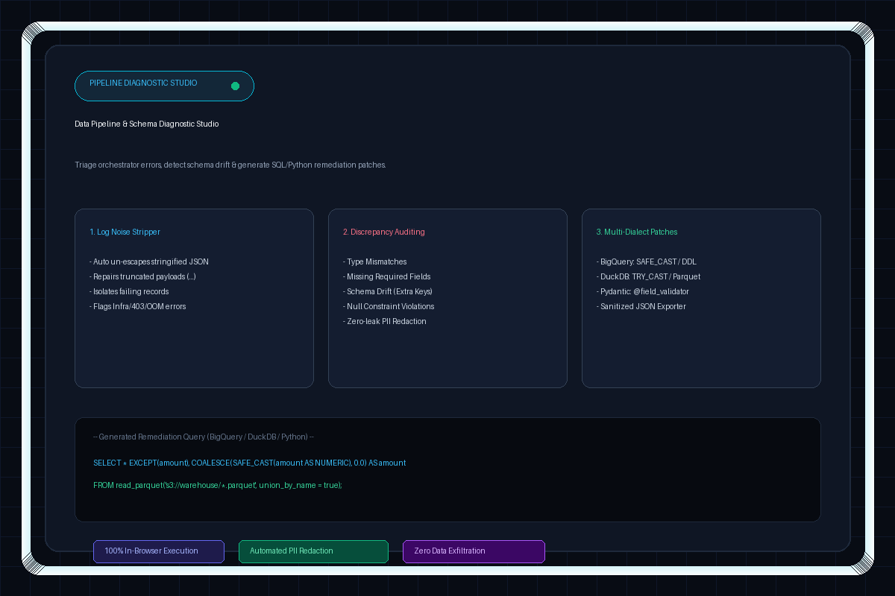

<p align="center">
  
</p>

# Pipeline Data & Schema Diagnostic Studio

[](https://faisal37990.github.io/pipeline-diagnostic-studio/)
[](https://faisal37990.github.io/pipeline-diagnostic-studio/test.html)
[](#)

> **Live Productivity App**: [https://faisal37990.github.io/pipeline-diagnostic-studio/](https://faisal37990.github.io/pipeline-diagnostic-studio/)

**Pipeline Data & Schema Diagnostic Studio** is an in-browser triage tool designed to triage orchestrator pipeline error logs, isolate corrupted payloads, detect schema discrepancies, and generate executable remediation code patches with zero data exfiltration.

---

## Features

1. **Header & Interactive Quick Presets**:
   - `BigQuery / Airflow Mismatch`: Airflow task failure with invalid timestamp calendar strings (`2024-02-30T14:00:00Z`) and string `"N/A"` in `NUMERIC` column.
   - `DuckDB Parquet Mismatch`: DuckDB `ConversionException` on float string `'124.85'` into `INT32` and Parquet schema drift.
   - `Pydantic / Python Validation`: Pydantic v2 `ValidationError` with missing required nested key `customer.email` and string number `'ten'` in integer field.

2. **Dual-Input Configuration**:
   - **Target Dialect Selector**: BigQuery (`SAFE_CAST`, `SAFE.PARSE_TIMESTAMP`), DuckDB (`TRY_CAST`, `union_by_name`), Python / Pydantic (`@field_validator`, schema sanitization).
   - **Input 1 (Required)**: Accepts full stack traces, Airflow/Kubernetes logs, stringified JSON dumps (`\"`), or raw payloads.
   - **Input 2 (Optional)**: Accepts SQL `CREATE TABLE` DDL, JSON Schema, or reference valid JSON. If omitted, schema is auto-inferred.

3. **Resilient Parsing & Diagnostic Engine**:
   - **Noise Stripping & JSON Recovery**: Auto-strips stack-trace noise, unescapes stringified quotes (`\"`), repairs truncated payloads (`...`), and normalizes Python dictionary dumps.
   - **Infrastructure Error Detection**: Identifies `403 Forbidden`, `AccessDenied`, `Connection Refused`, `Out Of Memory` (OOMKilled), and Rate Limit errors. Produces actionable DevOps runbooks instead of false schema diffs.
   - **Strict PII Masking**: Automatically masks email addresses (`[REDACTED_EMAIL]`), phone numbers (`[REDACTED_PHONE]`), and bearer tokens/API secrets (`[REDACTED_SECRET]`) across all outputs.

4. **Dedicated Output Cards**:
   - **Root-Cause Triage Banner**: Color-coded status badge, plain-English root cause summary, and metadata chips (`Task ID`, `DAG ID`, `Job ID`, `Line Number`, `Timestamp`).
   - **Schema Diff Table**: Columns for `Field Path`, `Expected Type`, `Observed Value / Received Type`, `Issue Category` (Type Mismatch, Missing Required Field, Unexpected Extra Key, Null Constraint Violation), and `Action Needed`.
   - **Remediation Code Generator**: Dialect-specific code block with 1-click clipboard copy.
   - **Sanitized Payload Exporter**: Formatted JSON viewer with repaired values, highlighted redactions, and 1-click clipboard copy / file download.

---

## Project Structure

```
pipeline-diagnostic-studio/
├── index.html              # Core single-page structure
├── styles.css              # Custom Obsidian/Slate dark data-engineering theme
├── app.js                  # Main UI controller & state management
├── README.md               # Documentation & usage guide
└── engine/
    ├── parser.js           # Noise stripper, JSON repair, and infra error classifier
    ├── schemaAnalyzer.js   # DDL & JSON Schema parser, type validator, diff classifier
    ├── piiMasker.js        # Automatic regex PII detection & redaction
    ├── remediation.js      # Dialect-specific remediation code & payload repair
    └── presets.js          # Realistic pre-configured test scenarios
```

---

## Running Locally

Because this application uses standard ES Modules (`type="module"`), run it using any local HTTP static server:

```bash
# Using Python:
python -m http.server 8000

# Using Node / npx:
npx serve .

# Or using VS Code "Live Server" extension
```

Then navigate to `http://localhost:8000` in any modern web browser.
